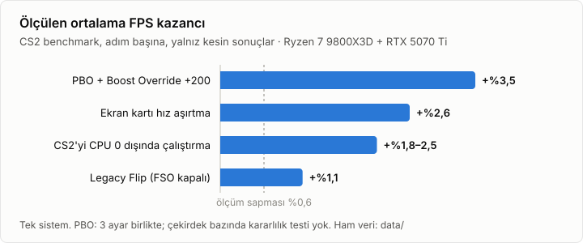

```
 ██████╗███████╗██████╗
██╔════╝██╔════╝╚════██╗
██║     ███████╗ █████╔╝
██║     ╚════██║██╔═══╝
╚██████╗███████║███████╗
 ╚═════╝╚══════╝╚══════╝
██████╗ ██╗ ██████╗ ███████╗
██╔══██╗██║██╔═══██╗██╔════╝
██████╔╝██║██║   ██║███████╗
██╔══██╗██║██║   ██║╚════██║
██████╔╝██║╚██████╔╝███████║
╚═════╝ ╚═╝ ╚═════╝ ╚══════╝
███████╗███████╗████████╗████████╗██╗███╗   ██╗ ██████╗ ███████╗
██╔════╝██╔════╝╚══██╔══╝╚══██╔══╝██║████╗  ██║██╔════╝ ██╔════╝
███████╗█████╗     ██║      ██║   ██║██╔██╗ ██║██║  ███╗███████╗
╚════██║██╔══╝     ██║      ██║   ██║██║╚██╗██║██║   ██║╚════██║
███████║███████╗   ██║      ██║   ██║██║ ╚████║╚██████╔╝███████║
╚══════╝╚══════╝   ╚═╝      ╚═╝   ╚═╝╚═╝  ╚═══╝ ╚═════╝ ╚══════╝
```

# CS2 BIOS, Windows and GPU tuning guide

[](LICENSE)
[](CHANGELOG.md)


Measured Counter-Strike 2 settings for a Ryzen 7 9800X3D and an RTX 5070 Ti. Includes raw data, measurement scripts and a settings check tool.

[Türkçe](README.md) · **English**

> [!NOTE]
> This page is an English summary. The detailed guides in [`docs/`](docs/README.md) are in Turkish. Tables, values, BIOS menu paths and commands are the same in both languages.

> [!WARNING]
> RAM and GPU overclocking, voltage increases and PBO can affect your warranty. The system can become unstable and you can lose data. You are responsible for any changes you make. All values were measured on a single system. This repository has no long memory test results and no per-core CPU stability test results.

## Contents

- [Key results](#key-results)
- [Quick start](#quick-start)
- [Documentation](#documentation)
- [Test system](#test-system)
- [Method](#method)
- [Repository layout](#repository-layout)
- [Contributing](#contributing)
- [Citation](#citation)
- [License](#license)

## Key results



| Setting | Average FPS | Decision |
|---|---|---|
| PBO Advanced, PBO Limits Motherboard, Boost Override +200 | **+3.5%** | Can be used. Test CPU stability. |
| GPU overclock (daily profile: +425 / +3000 / 116%) | **+2.6%** (shadows Low), **+3.3%** (shadows High) | Use |
| Run CS2 without CPU 0 (process affinity) | **+1.8% to +2.5%** (frame time p99 −3%, frame-to-frame variation −11%, PC latency −0.07 ms) | Use |
| Fullscreen optimizations off for `cs2.exe` (Legacy Flip) | **+1.13%** | Use |
| Manual RAM: DDR5-6000 CL28 1:1 (instead of manual DDR5-8000 CL34 Gear 2) | +0.2% to +0.4% (within variation) | No reliable difference shown. Both need a memory test. |
| DDR5 Nitro Mode 1-3-1 | **−1.4%** | Leave on Auto |
| Run CS2 with Vulkan | **−6%** | Keep DX11 (default) |
| GPU undervolt (VF curve) | Same FPS, −5 W | Do not use: driver reset in a long session |
| CS2 launch options (`-threads 9`, `-mainthreadpriority 2`, `-nojoy`, `engine_low_latency_sleep_after_client_tick`) | No effect (±0.1%) | Do not add |
| Custom OS settings (AtlasOS, ReviOS, RapidOS; only those that do not affect FACEIT) | No effect (−0.05% and +0.11%) | Not needed |
| Windows Game Mode | No effect (−0.21%) | Can stay off |
| Background apps at lowest priority (Process Lasso style) | No effect (−0.07%) | Not needed |
| Windows power plan (Balanced, High performance, Atlas or "Best performance" power mode; instead of the custom plan) | No effect (same FPS, smoothness and core clocks) | Balanced is enough |
| Power plan that parks cores or disables idle (RapidOS, "idle off") | **−4.9%** and **−7.4%**, smoothness also worse | Do not use |

**RAM:** The default recommendation is the kit's own EXPO/XMP profile. This profile was not measured in this repository. Manual DDR5-6000 1:1 is an alternative. Manual DDR5-8000 (1.60 V, tREFI 65535) is an advanced option. The comparison used two sessions for 6000 and only one session for 8000. The first 8000 session was 1.2% lower than the repeat with the same settings and was not used in the comparison. The current measurements do not show a reliable performance difference. The data is not sufficient to show that one profile is better or that the two are equivalent. This repository has no memory stability test for the 8000 profile. The absence of WHEA errors does not prove memory stability. Details: [BIOS: RAM](docs/bios.md#ram) (Turkish).

**PBO:** Measured with one 9800X3D. Three settings changed together, and the share of each setting was not measured. This repository has no per-core CPU stability test. Do not copy the values to another CPU.

**Total:** BIOS settings and the CPU 0 exclusion raised the average FPS from 911 to 970 (+6.4%). With the same BIOS, the CPU 0 exclusion and the GPU overclock raised it from 926.8 to 971.4 (+4.8%). Both totals include the CPU 0 step, so do not add them together.

All settings and decisions: [docs/results.md](docs/results.md) (Turkish).

## Quick start

Apply the settings in this order:

1. **[BIOS](docs/bios.md):** RAM (default: the kit's EXPO/XMP profile), CPU, settings that stay on Auto, FACEIT and security.
2. **[Windows and CS2](docs/windows.md):** CPU 0 exclusion, Legacy Flip, in-game settings.
3. **[GPU](docs/gpu.md):** MSI Afterburner profile.
4. **[Check](docs/verification.md):** Verify all settings with one command.

   ```powershell
   .\scripts\check\Test-Configuration.ps1
   ```

Use the same order after a BIOS update or a CMOS reset. On a different system, read [Adapting to other systems](docs/adapting.md) first.

## Documentation

| Page | Topic |
|---|---|
| [Results](docs/results.md) | Measured effect and decision for each setting |
| [BIOS](docs/bios.md) | RAM timings, PBO, settings that stay on Auto, FACEIT settings |
| [Windows and CS2](docs/windows.md) | CPU 0 exclusion, Legacy Flip, DPC measurement, power plan, in-game settings |
| [GPU](docs/gpu.md) | Daily profile, undervolt, shadow quality, finding your own limit |
| [Check](docs/verification.md) | Check script, steps after a BIOS update |
| [Adapting to other systems](docs/adapting.md) | Different RAM, CPU, motherboard or GPU |
| [Method](docs/methodology.md) | Benchmark, decision rules, sources of variation |
| [Troubleshooting](docs/troubleshooting.md) | No boot, WHEA, TDR, FACEIT, CS2 crashes |
| [Limitations](docs/limitations.md) | Limits of the measurements and untested topics |
| [Scripts](scripts/README.md) | Measurement, check and analysis scripts |
| [Data dictionary](data/README.md) | CSV files and columns |

## Test system

| Part | Value |
|---|---|
| CPU | AMD Ryzen 7 9800X3D |
| Motherboard | ASUS ROG STRIX X870-A GAMING WIFI, BIOS 2503 |
| Memory | 2 × 24 GB DDR5-8000, SK Hynix M-die |
| GPU | GIGABYTE GeForce RTX 5070 Ti AERO OC 16G, NVIDIA 617.42 (until 26.10), 621.12 (02.11) |
| Monitor | 1920×1080, 360 Hz |
| Operating system | Windows 11 Pro, build 26300 |

## Method

- **Benchmark:** Steam Workshop map `3240880604` (de_dust2), about 129 seconds. FPS values come from the CS2 VProf summary.
- **BIOS tests:** Each setting was measured in a separate CS2 session: 6 warm-up runs and 6 recorded runs. Session-to-session variation is usually ±0.6%; once it was 1.2%. The RAM and BCLK tests used 2 warm-up runs and 3 recorded runs, in A-B-A order. The A-B-A check held for DDR5-6000 and BCLK. It did not hold for DDR5-8000: two sessions with the same setting differed by 1.2%.
- **Windows and GPU tests:** Conditions were measured in the same CS2 session, in alternating or blocked order. Each run logged the GPU clock, power and driver errors.
- **Smoothness:** FPS alone does not show how the game feels. Tests with a PresentMon recording also report frame time deviation, frame-to-frame variation, the longest frame in each second, animation error and PC latency ([smoothness metrics](docs/methodology.md#akıcılık-ölçütleri), Turkish).
- **Data:** 132 runs and 2 matches in the BIOS tests. 308 runs, 53 Superposition runs and 24 stability tests in the Windows, GPU, RAM, BCLK, driver, Curve Optimizer, launch option, custom OS, Game Mode, latency, priority and power plan tests.

Details: [docs/methodology.md](docs/methodology.md) (Turkish).

## Repository layout

```text
.
├── docs/           Guide pages and chart (Turkish)
├── data/           Raw measurement data (CSV), anonymized CS2 logs, data dictionary
├── config/         BIOS target settings list
├── scripts/        PowerShell scripts
│   ├── bench/      CS2 benchmark automation and analysis
│   ├── bios/       NVRAM reading and BIOS setup dictionary
│   ├── check/      Settings check
│   ├── gpu/        Afterburner profiles and GPU measurement
│   ├── hwinfo/     HWiNFO sensor logging
│   └── windows/    Interrupt, DPC, PresentMon and dump analysis
├── .github/        Issue and pull request templates
├── CHANGELOG.md    Change log
├── CITATION.cff    Citation metadata
├── CODE_OF_CONDUCT.md  Code of conduct (Turkish)
├── CONTRIBUTING.md Contribution guide
├── SECURITY.md     Security policy (Turkish)
└── LICENSE         MIT license
```

## Contributing

You can share measurement results from your own system, report errors or suggest fixes. Issues and pull requests in English are welcome. Rules and templates: [CONTRIBUTING.md](CONTRIBUTING.md) (Turkish).

## Citation

If you use the data, use the **Cite this repository** link on the right side of the repository page ([CITATION.cff](CITATION.cff)).

## License

[MIT](LICENSE) © cs2-bios-settings contributors
