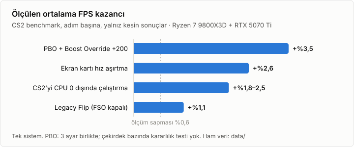

```
 ██████╗███████╗██████╗
██╔════╝██╔════╝╚════██╗
██║     ███████╗ █████╔╝
██║     ╚════██║██╔═══╝
╚██████╗███████║███████╗
 ╚═════╝╚══════╝╚══════╝
██████╗ ██╗ ██████╗ ███████╗
██╔══██╗██║██╔═══██╗██╔════╝
██████╔╝██║██║   ██║███████╗
██╔══██╗██║██║   ██║╚════██║
██████╔╝██║╚██████╔╝███████║
╚═════╝ ╚═╝ ╚═════╝ ╚══════╝
███████╗███████╗████████╗████████╗██╗███╗   ██╗ ██████╗ ███████╗
██╔════╝██╔════╝╚══██╔══╝╚══██╔══╝██║████╗  ██║██╔════╝ ██╔════╝
███████╗█████╗     ██║      ██║   ██║██╔██╗ ██║██║  ███╗███████╗
╚════██║██╔══╝     ██║      ██║   ██║██║╚██╗██║██║   ██║╚════██║
███████║███████╗   ██║      ██║   ██║██║ ╚████║╚██████╔╝███████║
╚══════╝╚══════╝   ╚═╝      ╚═╝   ╚═╝╚═╝  ╚═══╝ ╚═════╝ ╚══════╝
```

# CS2 BIOS, Windows ve ekran kartı ayar rehberi

[](LICENSE)
[](CHANGELOG.md)


Ryzen 7 9800X3D ve RTX 5070 Ti ile ölçülmüş CS2 ayarları. Ham veri, ölçüm betikleri ve ayar kontrol aracı dahil.

**Türkçe** · [English](README.en.md)

> [!WARNING]
> RAM ve ekran kartı hız aşırtması, voltaj artışı ve PBO garanti kapsamını etkileyebilir. Sistem kararsız çalışabilir ve veri kaybı olabilir. Tüm sorumluluk size aittir. Değerler tek bir sistemde ölçüldü. Bu depoda uzun bellek testi ve çekirdek bazında CPU kararlılık testi sonucu yoktur.

## İçindekiler

- [Öne çıkan sonuçlar](#öne-çıkan-sonuçlar)
- [Hızlı başlangıç](#hızlı-başlangıç)
- [Belgeler](#belgeler)
- [Test sistemi](#test-sistemi)
- [Ölçüm yöntemi](#ölçüm-yöntemi)
- [Depo yapısı](#depo-yapısı)
- [Katkı](#katkı)
- [Atıf](#atıf)
- [Lisans](#lisans)

## Öne çıkan sonuçlar



| Ayar | Ortalama FPS | Karar |
|---|---|---|
| PBO Advanced, PBO Limits Motherboard, Boost Override +200 | **+%3,5** | Kullanılabilir. CPU kararlılığını test edin. |
| Ekran kartı hız aşırtma (günlük profil: +425 / +3000 / %116) | **+%2,6** (gölge Düşük), **+%3,3** (gölge Yüksek) | Kullanın |
| CS2'yi CPU 0 dışında çalıştırma | **+%1,8 ile +%2,5** (kare süresi p99 −%3, kareden kareye fark −%11, PC gecikmesi −0,07 ms) | Kullanın |
| `cs2.exe` için tam ekran iyileştirmeleri kapalı (Legacy Flip) | **+%1,13** | Kullanın |
| Elle RAM: DDR5-6000 CL28 1:1 (elle DDR5-8000 CL34 Gear 2 yerine) | +%0,2 ile +%0,4 (sapma içinde) | Güvenilir fark gösterilmedi. İkisi de bellek testi gerektirir. |
| DDR5 Nitro Mode 1-3-1 | **−%1,4** | Auto bırakın |
| CS2'yi Vulkan ile çalıştırma | **−%6** | DX11 (varsayılan) kalsın |
| Ekran kartı undervolt (VF eğrisi) | FPS aynı, güç −5 W | Kullanmayın: uzun oturumda sürücü hatası |
| CS2 başlatma seçenekleri (`-threads 9`, `-mainthreadpriority 2`, `-nojoy`, `engine_low_latency_sleep_after_client_tick`) | Etki yok (±%0,1) | Eklemeyin |
| Custom OS ayarları (AtlasOS, ReviOS, RapidOS; FACEIT'e dokunmayanlar) | Etki yok (−%0,05 ve +%0,11) | Gerek yok |
| Windows Oyun Modu | Etki yok (−%0,21) | Kapalı kalabilir |
| Arka plan uygulamalarını düşük önceliğe çekmek (Process Lasso benzeri) | Etki yok (−%0,07) | Gerek yok |
| Windows güç planı (Dengeli, Yüksek performans, Atlas veya "En iyi performans" modu; özel plan yerine) | Etki yok (FPS, akıcılık ve çekirdek saatleri aynı) | Dengeli yeterli |
| Çekirdek park eden veya idle'ı kapatan güç planı (RapidOS, "idle off") | **−%4,9** ve **−%7,4**, akıcılık da kötüleşir | Kullanmayın |

**RAM:** Varsayılan öneri, kitin kendi EXPO/XMP profilidir. Bu profil bu depoda ölçülmedi. Elle DDR5-6000 1:1 bir alternatiftir. Elle DDR5-8000 (1,60 V, tREFI 65535) ileri düzey bir seçenektir. Karşılaştırmada 6000 için iki oturum, 8000 için yalnızca bir oturum kullanıldı. İlk 8000 oturumu, aynı ayarların tekrar ölçümünden %1,2 düşük çıktı ve karşılaştırmaya alınmadı. Mevcut ölçümler güvenilir bir performans farkı ortaya koymuyor. Veriler bir üstünlüğü veya eşdeğerliği göstermek için yetersizdir. Bu depoda 8000 profili için bellek kararlılık testi yoktur. WHEA hatası olmaması bellek kararlılığını kanıtlamaz. Ayrıntı: [BIOS: RAM](docs/bios.md#ram).

**PBO:** Tek bir 9800X3D ile ölçüldü. Üç ayar birlikte değişti ve her ayarın payı ayrı ölçülmedi. Bu depoda çekirdek bazında CPU kararlılık testi yoktur. Değerleri başka bir işlemciye kopyalamayın.

**Toplam:** BIOS ayarları ve CPU 0 dışlama ile ortalama FPS 911'den 970'e çıktı (+%6,4). Aynı BIOS ile CPU 0 dışlama ve ekran kartı hız aşırtması 926,8'den 971,4'e çıkardı (+%4,8). İki toplam CPU 0 adımını ortak içerir. Bu nedenle toplamları birbirine eklemeyin.

Tüm ayarlar ve kararlar: [docs/results.md](docs/results.md).

## Hızlı başlangıç

Ayarları bu sırayla uygulayın:

1. **[BIOS](docs/bios.md):** RAM (varsayılan: kitin EXPO/XMP profili), işlemci, Auto kalacak ayarlar, FACEIT ve güvenlik.
2. **[Windows ve CS2](docs/windows.md):** CPU 0 dışlama, Legacy Flip, oyun içi ayarlar.
3. **[Ekran kartı](docs/gpu.md):** MSI Afterburner profili.
4. **[Kontrol](docs/verification.md):** Tüm ayarları tek komutla doğrulayın.

   ```powershell
   .\scripts\check\Test-Configuration.ps1
   ```

BIOS güncellemesinden veya CMOS sıfırlamasından sonra aynı sırayı izleyin. Başka bir sistem kullanıyorsanız önce [Başka sistemlere uyarlama](docs/adapting.md) sayfasını okuyun.

## Belgeler

| Sayfa | Konu |
|---|---|
| [Sonuçlar](docs/results.md) | Her ayarın ölçülen etkisi ve kararı |
| [BIOS](docs/bios.md) | RAM zamanlamaları, PBO, Auto kalacak ayarlar, FACEIT ayarları |
| [Windows ve CS2](docs/windows.md) | CPU 0 dışlama, Legacy Flip, DPC ölçümü, güç planı, oyun içi ayarlar |
| [Ekran kartı](docs/gpu.md) | Günlük profil, undervolt, gölge kalitesi, kendi sınırınızı bulma |
| [Kontrol](docs/verification.md) | Kontrol betiği, BIOS güncellemesinden sonra yapılacaklar |
| [Başka sistemlere uyarlama](docs/adapting.md) | Farklı RAM, işlemci, anakart veya ekran kartı |
| [Ölçüm yöntemi](docs/methodology.md) | Benchmark, karar kuralları, sapma kaynakları |
| [Sorun giderme](docs/troubleshooting.md) | Açılmama, WHEA, TDR, FACEIT, CS2 çökmeleri |
| [Sınırlar](docs/limitations.md) | Ölçümün sınırları ve test edilmeyen konular |
| [Betikler](scripts/README.md) | Ölçüm, kontrol ve analiz betikleri |
| [Veri sözlüğü](data/README.md) | CSV dosyaları ve sütunları |

## Test sistemi

| Parça | Değer |
|---|---|
| İşlemci | AMD Ryzen 7 9800X3D |
| Anakart | ASUS ROG STRIX X870-A GAMING WIFI, BIOS 2503 |
| Bellek | 2 × 24 GB DDR5-8000, SK Hynix M-die |
| Ekran kartı | GIGABYTE GeForce RTX 5070 Ti AERO OC 16G, NVIDIA 617.42 (26.10'a kadar), 621.12 (02.11) |
| Ekran | 1920×1080, 360 Hz |
| İşletim sistemi | Windows 11 Pro, derleme 26300 |

Tam liste: [Ölçüm yöntemi](docs/methodology.md#test-sistemi).

## Ölçüm yöntemi

- **Benchmark:** Steam Workshop haritası `3240880604` (de_dust2), yaklaşık 129 saniye. FPS değerleri CS2'nin VProf özetinden alındı.
- **BIOS testleri:** Her ayar ayrı bir CS2 oturumunda ölçüldü: 6 ısınma koşusu ve 6 kayıt koşusu. Oturumlar arası sapma genelde ±%0,6'dır, bir kez %1,2 görüldü. RAM ve BCLK testleri ise 2 ısınma ve 3 kayıt koşusuyla, A-B-A sırasıyla ölçüldü. A-B-A kontrolü DDR5-6000 ve BCLK için tuttu. DDR5-8000 için tutmadı: aynı ayarın iki oturumu arasında %1,2 fark çıktı.
- **Windows ve ekran kartı testleri:** Koşullar aynı CS2 oturumunda dönüşümlü veya bloklu sırayla ölçüldü. Her koşuda GPU saati, gücü ve sürücü hataları kaydedildi.
- **Akıcılık:** FPS oyun hissini tek başına göstermez. PresentMon kaydı olan testlerde kare süresi sapması, kareden kareye fark, her saniyenin en uzun karesi, animasyon hatası ve PC gecikmesi de hesaplandı ([akıcılık ölçütleri](docs/methodology.md#akıcılık-ölçütleri)).
- **Veri:** BIOS testlerinde 132 koşu ve 2 maç. Windows, ekran kartı, RAM, BCLK, sürücü, Curve Optimizer, başlatma seçeneği, custom OS, Oyun Modu, gecikme, öncelik ve güç planı testlerinde 308 koşu, 53 Superposition koşusu ve 24 kararlılık testi.

Ayrıntı: [Ölçüm yöntemi](docs/methodology.md).

## Depo yapısı

```text
.
├── docs/           Rehber sayfaları ve grafik
├── data/           Ham ölçüm verisi (CSV), anonim CS2 logları, veri sözlüğü
├── config/         BIOS hedef ayar listesi
├── scripts/        PowerShell betikleri
│   ├── bench/      CS2 benchmark otomasyonu ve analiz
│   ├── bios/       NVRAM okuma ve BIOS ayar sözlüğü
│   ├── check/      Ayar kontrolü
│   ├── gpu/        Afterburner profilleri ve ekran kartı ölçümü
│   ├── hwinfo/     HWiNFO sensör kaydı
│   └── windows/    Kesme, DPC, PresentMon ve döküm analizi
├── .github/        Sorun ve pull request şablonları
├── CHANGELOG.md    Değişiklik günlüğü
├── CITATION.cff    Atıf bilgisi
├── CODE_OF_CONDUCT.md  Davranış kuralları
├── CONTRIBUTING.md Katkı rehberi
├── SECURITY.md     Güvenlik politikası
└── LICENSE         MIT lisansı
```

## Katkı

Kendi sisteminizdeki ölçüm sonuçlarını paylaşabilir, hata bildirebilir veya düzeltme önerebilirsiniz. Kurallar ve şablonlar: [CONTRIBUTING.md](CONTRIBUTING.md).

## Atıf

Bu depodaki verileri kullanırsanız sayfanın sağındaki **Cite this repository** bağlantısını kullanın ([CITATION.cff](CITATION.cff)).

## Lisans

[MIT](LICENSE) © cs2-bios-settings contributors
