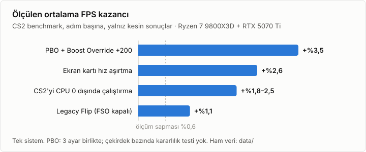

# Sonuçlar

Her ayarın CS2 benchmarkındaki ölçülen etkisi ve kararı. Ölçüm yöntemi ve karar kuralları: [Ölçüm yöntemi](methodology.md).

## Ayar başına etki

**Kesin** = fark ölçüm sapmasından büyük ve tekrarlanabilir. **Sapma içinde** = fark ayırt edilemez.

| Adım | Ortalama FPS | Karar |
|---|---|---|
| RAM 8000 (BIOS 2402'den 2503'e geçişle birlikte) | +%1,2. Sonuç kesin değil. P1 +%4,3 ve P99 −%4,0 kesin. | Varsayılan değildir. İleri düzey seçenek. Bellek kararlılık testi gerektirir ([BIOS](bios.md#ddr5-8000-ileri-düzey)). |
| PBO Advanced, PBO Limits Motherboard, Boost Override +200 | **+%3,5** | Kullanılabilir. Tek sistemde ölçüldü. Üç ayar birlikte değişti. Çekirdek bazında CPU kararlılık testi yok. Kendi sisteminizde test edin. |
| CS2'yi CPU 0 dışında çalıştırma (Windows affinity) | **+%1,8 ile +%2,5** | Kullanın ([Windows](windows.md#cs2yi-cpu-0-dışında-çalıştırma)) |
| Curve Optimizer All Cores −10 | −%0,3. Etki yok. 02.11'de Auto ile taze oturumlarda: −10 %0,33 yüksek, aynı gün sapma %0,32. Ağır tüm çekirdek yükte saat +%2,6. | Auto bırakın ([BIOS, İşlemci](bios.md)). Çekirdek bazında kararlılık testi yapılmadı. |
| Core Tuning Config for Gaming Level 2 | Doğrulanmadı | Auto bırakın. Çekirdek bazında kararlılık testi yapılmadı. |
| DDR5 Nitro Mode 1-3-1 | **−%1,4** | Auto bırakın |
| Latency Under Load, Medium Load Boostit, LLC 6 | Sapma içinde | Auto bırakın |
| SMT kapalı | Etki yok | Auto bırakın (açık) |
| FCLK 2200 MHz (Ai Tweaker ve AMD Overclocking menüsünde) | +%0,23. Sapma içinde. 6 koşunun 5'inde yön aynı. | Kullanılabilir. WHEA hatası olursa 2000'e dönün. |
| Kitin kendi EXPO/XMP profili | Ölçülmedi | Varsayılan öneri. Açtıktan sonra bellek testi yapın ([BIOS](bios.md#varsayılan-kitin-expo-veya-xmp-profili)). |
| RAM DDR5-6000 CL28, UCLK = MEMCLK (1:1), 8000 Gear 2 yerine | +%0,2 ile +%0,4. Sapma içinde. 6000 iki oturumla, 8000 tek oturumla karşılaştırıldı. Mevcut ölçümler güvenilir bir fark veya eşdeğerlik göstermiyor. P1 ve P99'da da güvenilir fark görülmedi. | Alternatif. Bellek kararlılık testi gerektirir ([BIOS](bios.md#ddr5-6000-11-alternatifi)). |
| RAM DDR5-6200 1:1 (aynı zamanlamalar) | 6000'e göre −%0,2 (tek oturum, sapma içinde) | Kazanç gösterilmedi |
| RAM DDR5-6400 1:1 (aynı zamanlamalar) | Ölçülmedi. İki açılışta iki mavi ekran (`0xA`). | Kullanmayın |
| BCLK 101 MHz | +%0,4 (A-B-A ile doğrulandı). P1 aynı. | 100 bırakın. PCIe saati de artar. 102 açılmadı ([BIOS](bios.md#bclk)). |
| iGPU kapalı, Global C-state Enabled, Power Supply Idle Control Typical (birlikte) | Etki yok (+%0,25) | İsteğe bağlı |
| Yüksek işlem önceliği | Etki yok | Normal bırakın |
| Ekran kartı hız aşırtma: çekirdek +400, bellek +2750, güç %116 | **+%2,6** (gölge Yüksek ile +425: **+%3,3**) | Kullanın. Günlük değer: +425 / +3000 / %116 ([Ekran kartı](gpu.md#günlük-ayar-msi-afterburner-profil-1)) |
| Ekran kartı çekirdeği +400, +425 veya +450 (3172–3225 MHz) | Fark yok (±%0,3) | +425 kullanın. +450 iki kez sürücü hatası verdi. |
| Yalnızca ekran kartı belleği (+200'den +2750'ye) | +%0,2 | Zararsız. Kazancın neredeyse tamamı çekirdekten gelir. |
| Ekran kartı Core Voltage %100 (Afterburner) | Etki yok. Saat aynı kalırken +8 W. | Voltajı 0 bırakın |
| Ekran kartı undervolt: VF eğrisi 3245 MHz @ 990 mV | FPS aynı (iki oturum ortalaması −%0,05). Voltaj −25 mV, güç −6 W. | Kullanmayın. Uzun CS2 oturumunda sürücü hatası verdi. Gölge Yüksek ile de FPS kazancı yok ([Undervolt](gpu.md#undervolt-vf-eğrisi)). |
| Aynı voltajda (990 mV) daha düşük saat: 3195 veya 3145 MHz | −%0,4 ile −%0,6. Güç değişmez. | Kullanmayın |
| Resizable BAR, CS2 sürücü profilinde açık | Etki yok (−%0,04) | Sürücü varsayılanı (kapalı) kalsın |
| CS2'yi Vulkan ile çalıştırma (`-vulkan`) | **−%6** | DX11 (varsayılan) kalsın |
| `cs2.exe` için tam ekran iyileştirmeleri kapalı (Legacy Flip) | **+%1,13** (A-B-A ile doğrulandı). P1 ve gecikme aynı. | Kullanın ([Windows](windows.md#tam-ekran-iyileştirmelerini-kapatma-legacy-flip)) |
| CS2 gölge kalitesi Yüksek (Düşük yerine) | **−%4,7** (24.10'daki aynı ayarlı oturuma göre, 5 sıranın hepsinde −%4,4 ile −%5,0). P1 aynı. İlk ölçüm −%5,8 vermişti, ama o oturum %1,2 düşük çıktı. | Oyun tercihi ([Gölge Yüksek](gpu.md#gölge-kalitesi-yüksek-ile-2610)) |
| NVIDIA Low Latency Mode | Burada ölçülmedi. Dış veride (cs2kitchen, tıklama-ekran) etkisiz. | Varsayılan (kapalı) kalsın |
| NVIDIA sürücüsü 621.01 ve 621.12 (617.42 yerine) | −%0,8 ile −%1,3 (üç oturum). P1 ve P99 aynı. Aynı dönemde CS2 ve Windows da güncellendi. Sürücüye atfedilemez. | Kesin değil ([Windows](windows.md#nvidia-sürücüsü-ve-sürücü-ayarları)) |
| NVIDIA App genel 3D ayarları (güç maks. performans, V-Sync zorla kapalı, doku süzme yüksek performans, anizotropik kapalı) | Etki yok (−%0,28) | İsteğe bağlı |
| Doku süzme kalitesi: Kalite (Performans yerine) | −%0,36. Aynı ayarın iki oturumu arasında −%0,32. P1 ve P99 aynı. | Kesin değil. Kalite daha iyi değil. |
| CS2 başlatma seçeneği `-threads 9` | Etki yok (+%0,06, kontrol bloklarına göre) | Eklemeyin ([Windows](windows.md#cs2-başlatma-seçenekleri)) |
| `-threads 9 -mainthreadpriority 2` | Etki yok (−%0,04) | Eklemeyin |
| `-nojoy +violence_hblood 0 +engine_low_latency_sleep_after_client_tick true` | Etki yok (+%0,12). P1 −%2,4, sapma içinde. | Gerek yok. `violence_hblood` yalnızca görseldir. |
| Custom OS paketi (AtlasOS, ReviOS, RapidOS): 9 hizmet geçici durduruldu, Game DVR ve arka plan uygulamaları kapalı | Etki yok (−%0,05, kontrol bloklarına göre). P1 ve P99 aynı. Oyun içi arka plan yükü 0,0046 çekirdek azaldı. | Gerek yok ([Windows](windows.md#custom-os-ayarları-atlasos-revios-rapidos)) |
| Ethernet Energy Efficient Ethernet kapalı | Ölçülmedi | İsteğe bağlı |

## Toplam

**BIOS ve CPU 0 (19.10):** Ortalama FPS 911'den 970'e çıktı (**+%6,4**). Ortalama kare süresi 1,10 ms'den 1,03 ms'ye düştü. P99 değeri 2,99 ms'den 2,80 ms'ye düştü.

**Windows ve ekran kartı (23.10):** Aynı BIOS ayarlarıyla, CPU 0 dışlama ve ekran kartı hız aşırtması birlikte ortalama FPS'i 926,8'den 971,4'e çıkardı (**+%4,8**). Ekran kartının payı +%2,6, CPU 0 dışlamanın payı +%2,2'dir. Ölçüm iki ayrı CS2 oturumunda ters sırayla yapıldı. Dört alt karşılaştırmanın hepsi aynı yönü gösterdi.

> [!NOTE]
> İki toplamı birbirine eklemeyin. İkisi de CPU 0 adımını içerir. Ayrıca iki ölçüm arasında CS2 güncellendi. Oturumlar arası sapma genelde ±%0,6'dır, ama bir kez %1,2 görüldü. Bu nedenle BIOS toplamını **yaklaşık %6 ± 1** olarak okuyun.
>
> Her iki toplamda RAM elle DDR5-8000 profilindeydi. BIOS toplamı Curve Optimizer −10 ve Core Tuning Level 2 adımlarını da içerir. Bu ayarlar artık varsayılan öneri değildir ([BIOS](bios.md#ram)).

## Darboğaz

- **İşlemci:** CS2 sırasında tüm çekirdekler 5425 MHz'de çalıştı. Güç sınırının yalnızca %7,5'ini kullandı. Sıcaklık en fazla 60 °C oldu. Bu nedenle Curve Optimizer, PBO limitleri ve sıcaklık ayarları ek kazanç sağlamadı.
- **Ekran kartı:** PresentMon'a göre kare süresinin (~1,07 ms) ~0,98 ms'inde GPU meşguldür. CPU, kare başına ~0,37 ms GPU'yu bekler. Ama GPU süresinin yalnızca ~%20'si çekirdek saatiyle ölçeklenir: GPU saati %12 düşünce FPS %2,8 düştü, 3170 MHz'in üstünde kazanç ölçülemez. Bellek saati, Core Voltage, Resizable BAR ve Vulkan da bu sabit kısmı küçültmedi.
- **P1:** Hiçbir Windows veya ekran kartı ayarı P1 değerini ölçülebilir şekilde değiştirmedi. P1 değerinin koşudan koşuya sapması ±%5'tir.

## Günler arasındaki farklar

Aynı ayarlarla ölçülen ortalama FPS günden güne değişti. Nedenler ölçüldü:

| Gün | Ortalama FPS | Neden |
|---|---|---|
| 24.10 | 989–996 | Gölge Düşük |
| 25.10 | 950–966 | Arka planda bir uygulama yaklaşık 1 çekirdek kullandı (~−%3, P1 ~−%8) |
| 26.10 | 935–949 | Gölge kalitesi Yüksek (−%4,7). Aynı ayarlarla gece oturumu 935, öğleden sonra 946 ölçüldü (%1,2). Bu farkın nedeni bulunamadı. |
| 02.11 | 927–939 (kayıt) | NVIDIA 621.12, yeni CS2 ve Windows sürümü (26.10'a göre −%0,8). Aynı Windows oturumunda ilk ~40 dakikada %1'e varan düşüş. |

BIOS, sürücü, RAM ve CS2 sürümü 24–26.10 arasında değişmedi (26.10'daki RAM testleri hariç). Ayrıntı: [Sapma kaynakları](methodology.md#sapma-kaynakları).

Ham veri: [data/](../data/README.md).

---

[Belgeler dizini](README.md)
