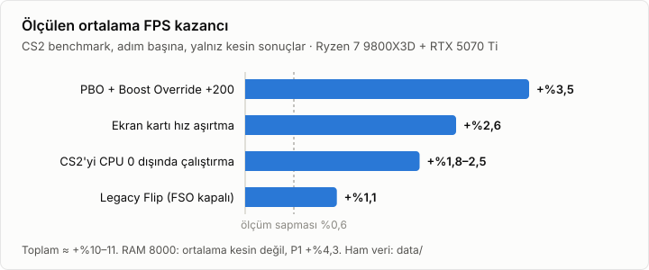

# Sonuçlar

Her ayarın CS2 benchmarkındaki ölçülen etkisi ve kararı. Ölçüm yöntemi ve karar kuralları: [Ölçüm yöntemi](methodology.md).

## Ayar başına etki

**Kesin** = fark ölçüm sapmasından büyük ve tekrarlanabilir. **Sapma içinde** = fark ayırt edilemez.

| Adım | Ortalama FPS | Karar |
|---|---|---|
| RAM 8000 (BIOS 2402'den 2503'e geçişle birlikte) | +%1,2. Sonuç kesin değil. P1 +%4,3 ve P99 −%4,0 kesin. | Kullanın |
| PBO Advanced, PBO Limits Motherboard, Boost Override +200 | **+%3,5** | Kullanın |
| CS2'yi CPU 0 dışında çalıştırma (Windows affinity) | **+%1,8 ile +%2,5** | Kullanın ([Windows](windows.md#cs2yi-cpu-0-dışında-çalıştırma)) |
| Curve Optimizer All Cores −10 | −%0,3. Etki yok. | Açık bırakın (zararsız) |
| Core Tuning Config for Gaming Level 2 | Doğrulanmadı | Açık bırakın (zararsız) |
| DDR5 Nitro Mode 1-3-1 | **−%1,4** | Auto bırakın |
| Latency Under Load, Medium Load Boostit, LLC 6 | Sapma içinde | Auto bırakın |
| SMT kapalı | Etki yok | Auto bırakın (açık) |
| FCLK 2200 MHz (Ai Tweaker ve AMD Overclocking menüsünde) | +%0,23. Sapma içinde. 6 koşunun 5'inde yön aynı. | Kullanılabilir. WHEA hatası olursa 2000'e dönün. |
| iGPU kapalı, Global C-state Enabled, Power Supply Idle Control Typical (birlikte) | Etki yok (+%0,25) | İsteğe bağlı |
| Yüksek işlem önceliği | Etki yok | Normal bırakın |
| Ekran kartı hız aşırtma: çekirdek +400, bellek +2750, güç %116 | **+%2,6** (gölge Yüksek ile +425: **+%3,3**) | Kullanın. Günlük değer: +425 / +3000 / %116 ([Ekran kartı](gpu.md#günlük-ayar-msi-afterburner-profil-1)) |
| Ekran kartı çekirdeği +400, +425 veya +450 (3172–3225 MHz) | Fark yok (±%0,3) | +425 kullanın. +450 iki kez sürücü hatası verdi. |
| Yalnızca ekran kartı belleği (+200'den +2750'ye) | +%0,2 | Zararsız. Kazancın neredeyse tamamı çekirdekten gelir. |
| Ekran kartı Core Voltage %100 (Afterburner) | Etki yok. Saat aynı kalırken +8 W. | Voltajı 0 bırakın |
| Ekran kartı undervolt: VF eğrisi 3245 MHz @ 990 mV | FPS aynı (iki oturum ortalaması −%0,05). Voltaj −25 mV, güç −6 W. | Kullanmayın. Uzun CS2 oturumunda sürücü hatası verdi. Gölge Yüksek ile de FPS kazancı yok ([Undervolt](gpu.md#undervolt-vf-eğrisi)). |
| Aynı voltajda (990 mV) daha düşük saat: 3195 veya 3145 MHz | −%0,4 ile −%0,6. Güç değişmez. | Kullanmayın |
| Resizable BAR, CS2 sürücü profilinde açık | Etki yok (−%0,04) | Sürücü varsayılanı (kapalı) kalsın |
| CS2'yi Vulkan ile çalıştırma (`-vulkan`) | **−%6** | DX11 (varsayılan) kalsın |
| `cs2.exe` için tam ekran iyileştirmeleri kapalı (Legacy Flip) | **+%1,13** (A-B-A ile doğrulandı). P1 ve gecikme aynı. | Kullanın ([Windows](windows.md#tam-ekran-iyileştirmelerini-kapatma-legacy-flip)) |
| CS2 gölge kalitesi Yüksek (Düşük yerine) | **−%5,8** (24.10'daki aynı ayarlı oturuma göre, 5 sıranın hepsinde −%5,7 ile −%6,1). P1 ~−%4, dağınık. | Oyun tercihi ([Gölge Yüksek](gpu.md#gölge-kalitesi-yüksek-ile-2610)) |
| NVIDIA Low Latency Mode | Burada ölçülmedi. Dış veride (cs2kitchen, tıklama-ekran) etkisiz. | Varsayılan (kapalı) kalsın |
| Ethernet Energy Efficient Ethernet kapalı | Ölçülmedi | İsteğe bağlı |

## Toplam

**BIOS ve CPU 0 (19.10):** Ortalama FPS 911'den 970'e çıktı (**+%6,4**). Ortalama kare süresi 1,10 ms'den 1,03 ms'ye düştü. P99 değeri 2,99 ms'den 2,80 ms'ye düştü.

**Windows ve ekran kartı (23.10):** Aynı BIOS ayarlarıyla, CPU 0 dışlama ve ekran kartı hız aşırtması birlikte ortalama FPS'i 926,8'den 971,4'e çıkardı (**+%4,8**). Ekran kartının payı +%2,6, CPU 0 dışlamanın payı +%2,2'dir. Ölçüm iki ayrı CS2 oturumunda ters sırayla yapıldı. Dört alt karşılaştırmanın hepsi aynı yönü gösterdi.

> [!NOTE]
> İki toplamı birbirine eklemeyin. İkisi de CPU 0 adımını içerir. Ayrıca iki ölçüm arasında CS2 güncellendi. Oturumlar arası sapma ±%0,6'dır. Bu nedenle BIOS toplamını **yaklaşık %6 ± 0,6** olarak okuyun.

## Darboğaz

- **İşlemci:** CS2 sırasında tüm çekirdekler 5425 MHz'de çalıştı. Güç sınırının yalnızca %7,5'ini kullandı. Sıcaklık en fazla 60 °C oldu. Bu nedenle Curve Optimizer, PBO limitleri ve sıcaklık ayarları ek kazanç sağlamadı.
- **Ekran kartı:** PresentMon'a göre kare süresinin (~1,07 ms) ~0,98 ms'inde GPU meşguldür. CPU, kare başına ~0,37 ms GPU'yu bekler. Ama GPU süresinin yalnızca ~%20'si çekirdek saatiyle ölçeklenir: GPU saati %12 düşünce FPS %2,8 düştü, 3170 MHz'in üstünde kazanç ölçülemez. Bellek saati, Core Voltage, Resizable BAR ve Vulkan da bu sabit kısmı küçültmedi.
- **P1:** Hiçbir Windows veya ekran kartı ayarı P1 değerini ölçülebilir şekilde değiştirmedi. P1 değerinin koşudan koşuya sapması ±%5'tir.

## Günler arasındaki farklar

Aynı ayarlarla ölçülen ortalama FPS günden güne değişti. Nedenler ölçüldü:

| Gün | Ortalama FPS | Neden |
|---|---|---|
| 24.10 | 989–996 | Gölge Düşük |
| 25.10 | 950–966 | Arka planda bir uygulama yaklaşık 1 çekirdek kullandı (~−%3, P1 ~−%8) |
| 26.10 | 935 | Gölge kalitesi Yüksek (−%5,8) |

BIOS, sürücü, RAM ve CS2 sürümü bu üç günde değişmedi. Ayrıntı: [Sapma kaynakları](methodology.md#sapma-kaynakları).

Ham veri: [data/](../data/README.md).

---

[Belgeler dizini](README.md)
